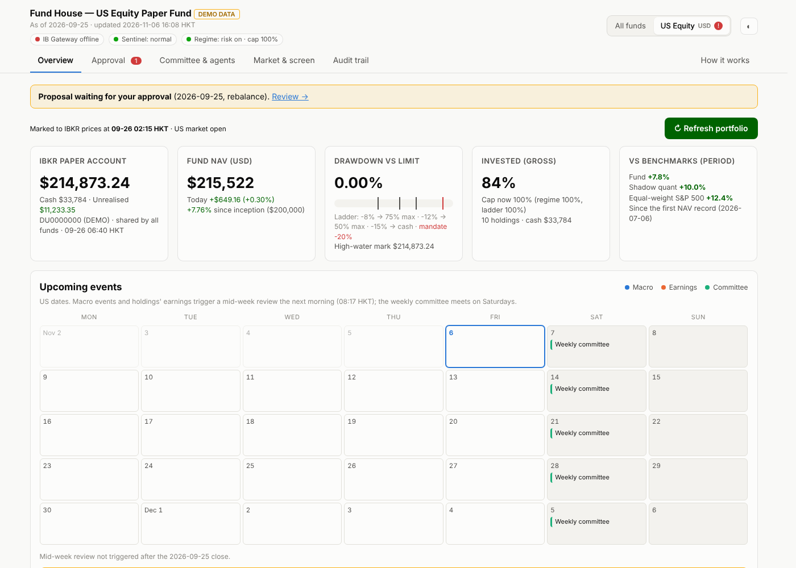
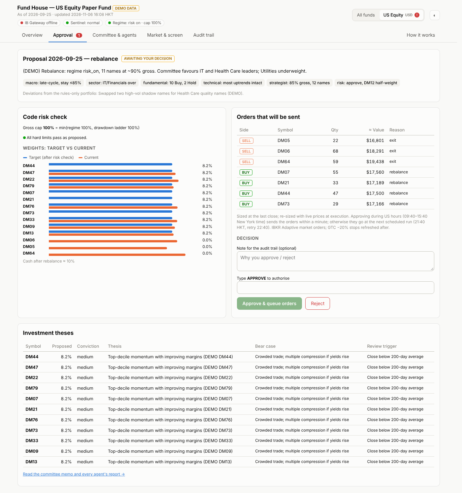
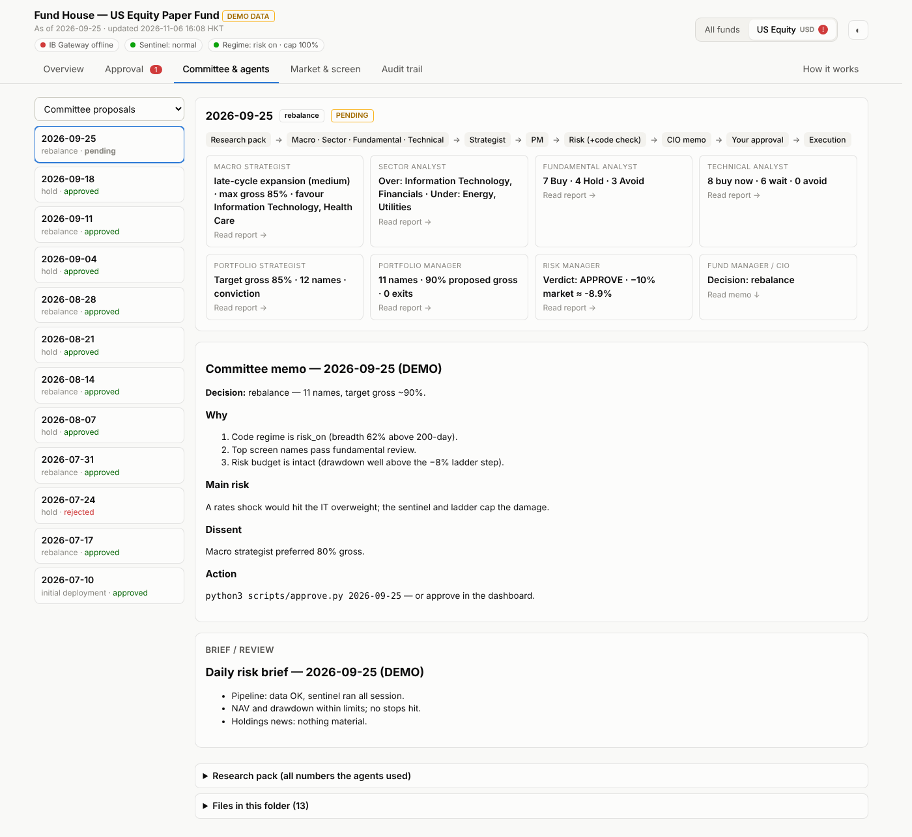

# Multi-Agent Fund House

[](https://github.com/namm2008/multi-agent-fund-house/actions/workflows/tests.yml)


**A small "fund house" run by AI agents.** A committee of Claude agents (macro strategist, sector analyst, fundamental analyst, technical analyst, portfolio strategist, portfolio manager, risk manager and CIO) researches a US stock portfolio every week. **Plain Python enforces every risk limit, and a human approves every trade.** It trades an Interactive Brokers *paper* account.

> **Agents propose. Code enforces. A human approves.**
> The LLMs never touch the broker, never change a limit, and cannot argue with the risk code.



---

## Why this design

Most multi-agent trading demos skip three hard problems. This project is built around them:

| Problem | Why it matters | What this project does |
|---|---|---|
| **An LLM committee can't be backtested honestly** | The models have read about the period you'd test on (look-ahead leakage) | A deterministic **quant core** (screen + regime + drawdown ladder + stops) does the heavy lifting and *is* backtestable. Agents may only pick from its top-40. A **shadow quant-only portfolio** runs alongside, so you can measure whether the agents add value |
| **A crash watch can't be an LLM** | Scheduled agent runs are hourly at best and start cold each time | A **Python sentinel** checks every 5 minutes in US hours and de-risks automatically. A **GTC stop parked at IBKR** protects each holding even if the computer is off |
| **A 20% max drawdown can't be guaranteed** | Gaps and correlated crashes make stops fill below their trigger | **Layered defences** whose last step goes to cash at **−15%**, leaving a buffer for gaps (tested on S&P 500 history 1950–2026, see [docs/DESIGN.md](docs/DESIGN.md)) |

## How it works

```
Claude (scheduled tasks)              Your computer (launchd / cron)          IBKR paper
┌────────────────────────────┐        ┌───────────────────────────────┐      ┌───────────┐
│ Weekly investment committee│ reads  │ After-close daily_update.py   │◄────►│ IB Gateway│
│  macro · sector · fund.    │◄───────│  bars · SEC EDGAR · FRED      │      │  (paper)  │
│  · technical  (independent)│  pack  │  stops · ladder · screen ·    │      │           │
│  → strategist → PM         │        │  regime · research pack       │      │ GTC stop  │
│  → risk (code check) → CIO │        │                               │      │ per stock │
│ writes target_portfolio    │───────►│ YOU: approve (dashboard/CLI)  │      │           │
│ Daily risk brief           │        │ execute.py after US open ─────┼─────►│  orders   │
└────────────────────────────┘        │ sentinel.py every 5 min ──────┼─────►│           │
   LLMs never touch orders            └───────────────────────────────┘      └───────────┘
```

1. **Data and rules (Python, daily).** Prices from IBKR, fundamentals from SEC EDGAR (point-in-time, by filing date), 12 macro series from FRED. The code marks the fund's own ledger, checks stops and the drawdown ladder, runs the quant screen (momentum 35%, quality 25%, trend 20%, growth 20%, high-volatility penalty) and the market regime, then writes a **research pack**: the only source of numbers the agents may use.
2. **Investment committee (Claude agents, weekly).** Four analysts work **independently and in parallel**, so they can't herd. The strategist sets exposure and tilts, the PM picks names and weights from the top-40, the risk manager runs `scripts/check_proposal.py` (a code check, not an opinion), and the CIO writes a one-page memo and a machine-readable `target_portfolio.json`. "Hold" is a first-class decision.
3. **Human approval.** Read the memo, the code risk check and the exact order preview in the dashboard, then type `APPROVE`, or reject it with a note. Nothing that *adds* risk trades without you.
4. **Execution and protection (Python).** Approved orders go out after the next US open. Stops are refreshed at IBKR. The sentinel watches intraday and *reduces* risk on its own, no approval needed.
5. **Mid-week review.** After each close, an event gate checks for things like FOMC/CPI days, holdings' earnings, a regime change or red-flag 8-K filings. If it fires, a short macro + PM + risk review runs the next morning.

### Risk defence layers (all in code: [`fh/risk.py`](fh/risk.py), [`fh/config.py`](fh/config.py))

| Layer | Trigger | Action |
|---|---|---|
| Regime cap (daily) | Equal-weight index trend, breadth, HY credit spread, VIX | Max gross exposure 100% / 70% / 30% |
| Drawdown ladder | Fund −8% / −12% / −15% from high-water mark | Max gross 75% / 50% / **0% and halt** |
| Position stops | −15% from entry; −25% from peak once in profit | Exit at next open |
| Server-side stop | −20% from entry, GTC at IBKR | Fires even if your computer is off |
| Rank-buffer exit | Holding ranks worse than 60 on 2 consecutive weeks | Sold at next open |
| Sentinel shock / crash | Market −3% intraday · −5% day / −8% 3-day / VIX ≥ 40 | Freeze buys 4 days · cut gross to 50% |
| Kill switch | `touch STOP_TRADING` | Halts buys; `scripts/liquidate.py` goes to cash |

Portfolio constraints: 10–15 names, 4–10% each, ≤30% per GICS sector, ≥2% cash, one-way turnover ≤40%/month, no shorts, options or leverage. The code only works with **paper** accounts: [`fh/ib.py`](fh/ib.py) refuses live ports and non-paper account IDs.

## Screenshots (synthetic demo data)

| Approval: code risk check + exact orders | Committee: every agent's report + CIO memo |
|---|---|
|  |  |

## Try it in 1 minute (no broker needed)

```bash
git clone https://github.com/namm2008/multi-agent-fund-house.git
cd multi-agent-fund-house
python3 -m pip install -r requirements.txt
python3 dashboard/server.py --demo --port 8766    # open http://127.0.0.1:8766
python3 -m pytest -q                              # offline test suite
```

The demo generates a synthetic fund (tickers `DM01`… and account `DU0000000`), so you can click through every tab: Overview, Approval, Committee & agents, Market & screen, Audit trail and *How it works*.

## Running it for real (paper)

1. **IB Gateway (paper):** enable socket clients on port **4002**, trusted IP `127.0.0.1`, untick *Read-Only API*, and turn on auto-restart.
2. **Settings:** `cp .env.example .env`, put your contact e-mail in it (SEC and FRED ask for one), then `set -a; source .env; set +a`. All mandate numbers live in [`fh/config.py`](fh/config.py).
3. **Check and seed:**
   ```bash
   python3 scripts/check_setup.py      # every line should say [ok]
   python3 scripts/daily_update.py     # first run downloads ~500 stocks: 10–20 min
   python3 scripts/status.py
   ```
4. **Backtest the quant core before trusting it:**
   `python3 scripts/download_history.py --years 12` then `python3 scripts/backtest_core.py --start 2015-01-01`.
5. **Schedule the jobs:** `bash deploy/setup_mac.sh` (macOS launchd: daily data, execution, sentinel, dashboard), or use the Docker + cron template in `deploy/docker/` for a VPS.
6. **Schedule the committee:** create Claude scheduled tasks (weekly committee + daily risk brief) that follow [`agents/PIPELINE.md`](agents/PIPELINE.md) on a computer with the fund folder connected.

Default schedule (Hong Kong time, edit in `deploy/`): data Tue–Sat 06:30 · committee Saturday · execution Mon–Fri 21:40 / 22:40 · sentinel continuous in US hours.

### Everyday controls

| Need | Do |
|---|---|
| Approve / reject the week's proposal | Dashboard → Approval tab, or `python3 scripts/approve.py` |
| See state | `python3 scripts/status.py` |
| Dry-run execution | `python3 scripts/execute.py --dry-run --force` |
| Stop everything | `touch STOP_TRADING` |
| Go to cash now | `python3 scripts/liquidate.py` |
| Restart after a halt | delete `STOP_TRADING`, then `python3 scripts/reset_hwm.py` |

## Repository layout

```
fh/          library: config (the mandate), data, factors (screen + regime), risk, ledger,
             orders, sentinel logic, research pack, filings, mid-week gate, approval
scripts/     jobs: daily_update, execute, sentinel, approve, check_proposal, backtest_core, status …
agents/      00_CHARTER.md (read by every agent) · PIPELINE.md (orchestrator) ·
             roles/ 9 role prompts · schemas/target_portfolio.schema.json
dashboard/   local web app (standard library server, 127.0.0.1 only) + synthetic demo data
deploy/      macOS launchd installer, Docker + cron template
tests/       offline tests: ledger, ladder, stops, crash rules, order sizing, EDGAR parsing,
             end-to-end pack → proposal → orders, sentinel on a fake broker
docs/        DESIGN.md (feasibility, architecture, drawdown study) and screenshots
```

Runtime folders (`data/`, `state/`, `research/<date>/`, `logs/`) are created on first run and are **git-ignored**. Every week leaves a full audit trail on your machine: `pack → analyst reports → proposal → risk check → memo → approval → execution`.

## Honest limitations

- **This is a research and learning project, not a proven strategy.** The goal of the first 6–12 months is to prove the *process*: it runs unattended, respects risk, and beats its own quant shadow after costs.
- The LLM layer can only be judged **forward**, on paper. Pre-committed rule: if after 26 weeks the committee trails the shadow quant portfolio after costs, LLM stock selection gets dropped.
- The core backtest uses today's S&P 500 list, so it has survivorship bias (treat it as an upper bound).
- Free data has gaps: EDGAR tags vary and FRED lags. The pipeline flags stale data and blocks the committee instead of guessing.

## Tech

Python 3.10+ · pandas / numpy / pyarrow · [`ib_async`](https://github.com/ib-api-reloaded/ib_async) · SEC EDGAR · FRED · Claude agents (scheduled tasks, web search, subagents) · Chart.js dashboard · launchd / Docker.

## Disclaimer

For education and research only. Not investment advice. It is built for and tested against **paper trading only**. Use it with real money at your own risk.
